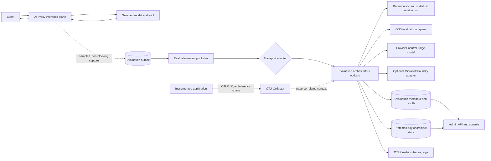

# AI Proxy - Evaluation as a Service Architecture

## 1. Status and intent

This document proposes **Evaluation as a Service (EaaS)** as a future AI Proxy capability. It is an architecture
specification, not an implementation plan, and does not change the behavior described in
[architecture.md](architecture.md).

The design keeps the project's defining property: the core proxy is self-hosted and cloud/provider agnostic.
Microsoft Foundry is supported as an optional evaluator and observability destination, not as a required control
plane, data store, schema, or runtime dependency.

The recommended shape is a separate **evaluation plane** fed asynchronously by the proxy. Production evaluation can
run continuously at a configurable sample rate, while offline datasets and CI/CD runs use the same evaluator
definitions and normalized result format.

## 2. Goals

- Evaluate outputs from OpenAI-compatible, Microsoft AI, Anthropic, and future provider routes through one contract.
- Enable continuous production evaluation without adding judge latency or availability dependencies to inference.
- Allow evaluation to be turned off globally or scoped by model, API route, consumer, and operation.
- Support deterministic checks, statistical metrics, LLM-as-a-judge, RAG, safety, agent/conversation, human feedback,
  operational, cost, and business metrics.
- Reuse AI Proxy's authenticated consumer identity, model/endpoint attribution, usage capture, PostgreSQL, and
  OpenTelemetry foundations.
- Support self-hosted open-source evaluators by default and managed services, including Microsoft Foundry, through
  adapters.
- Make every result reproducible enough to compare model, prompt, evaluator, and dataset versions over time.
- Minimize, classify, redact, encrypt, retain, and delete captured content deliberately.
- Expose evaluation through an API and admin experience without requiring applications to adopt one evaluation SDK.

## 3. Non-goals

- Blocking an inference response while an evaluator runs.
- Treating evaluation scores as objective truth or as a substitute for human review.
- Automatically changing model routing from a single score. Quality-aware routing requires a separately approved
  policy with minimum sample sizes, confidence bounds, freshness rules, and rollback behavior.
- Inferring RAG retrieval quality from prompt and response text alone. Retrieval context and ground truth must come
  from application traces, an explicit submission, or a dataset.
- Capturing every prompt and response by default.
- Replacing the existing chargeback `UsageRecord`. Evaluation records correlate with usage records but have a
  different lifecycle, sensitivity, and retention policy.
- Mandating Langfuse, Phoenix, MLflow, Foundry, a broker, an object store implementation, or a judge-model provider.
- Cross-protocol inference translation.

## 4. Architectural principles and decisions

### 4.1 Separate the inference plane from the evaluation plane

The proxy remains responsible for authentication, authorization, routing, failover, protocol-preserving forwarding,
and usage capture. It may create an evaluation capture, but it never executes an evaluator on the request path.

Evaluation is performed by separately deployable workers. Evaluation queue saturation, judge throttling, malformed
outputs, a broken dashboard, or an unavailable managed service must not alter the inference response.

### 4.2 Open contracts at every external boundary

- **Telemetry transport:** OTLP.
- **Evaluation event envelope:** CloudEvents 1.0.
- **Trace correlation:** W3C Trace Context.
- **GenAI attributes:** the OpenTelemetry GenAI semantic conventions, with an explicit schema version.
- **RAG/agent enrichment:** accept OpenInference attributes and span kinds when application instrumentation emits them.
- **Evaluator execution:** an AI Proxy-owned evaluator contract, not a vendor SDK type.
- **Storage:** repository and object-store ports; PostgreSQL and an S3-compatible API are possible adapters.

OTLP is stable for traces, metrics, and logs. The OpenTelemetry GenAI semantic conventions are still marked
**Development**, so captures must record their semantic-convention version and pass through a normalization layer.
OpenInference is complementary and more expressive for retriever, reranker, tool, agent, and guardrail spans. Neither
attribute vocabulary is the canonical persistence model.

### 4.3 Metadata and payloads are different data classes

Low-cardinality operational metadata belongs in OpenTelemetry. Raw prompts, responses, retrieval context, tool
arguments, ground truth, and judge explanations do **not** belong in metric labels or ordinary span attributes.

Evaluation events contain metadata and opaque payload references. Sensitive payloads are stored separately with
encryption, access control, retention, and deletion policies. Small redacted payloads may be inlined only when a
deployment explicitly allows it.

### 4.4 At-least-once processing and idempotent results

Continuous evaluation is best effort with respect to the already-completed inference request, but durable and
at-least-once after a capture reaches the outbox. Every work item and result has an idempotency key. Workers may retry
without creating duplicate logical results.

### 4.5 Version everything that can change a score

An evaluation result is meaningful only with the exact evaluator definition, implementation, judge prompt, judge
model, normalization schema, input payload, and applicable policy version. Mutating definitions create new versions;
historical results remain attached to their original versions.

## 5. Context-specific architecture



The existing proxy already has useful integration points:

- `ProxyRoutingService` knows the authenticated consumer, logical model, selected model endpoint, provider, operation,
  status, duration, request body, and extracted usage.
- `SseStreamRelay` and the Realtime relay already observe response events without changing client-visible bytes.
- `UsageRecordChannel` demonstrates asynchronous handoff, but its process-local drop-on-full semantics are not durable
  enough for evaluation payloads.
- PostgreSQL is already the system of record for configuration and usage.
- `AiProxyMetrics`, `AiProxyActivitySource`, and `AiProxy.ServiceDefaults` already export through OTLP.
- The React admin console can later add evaluation policy, run, result, dataset, and feedback views.

Evaluation capture should be a new port invoked by routing/relay code, not evaluation logic embedded in those classes.
The Application layer owns policy resolution and contracts. Infrastructure supplies capture, outbox, storage,
transport, evaluator, and managed-service adapters. The Api remains the composition root and HTTP surface.

## 6. Online continuous evaluation flow

1. The caller is authenticated and authorized using the current Consumer flow.
2. After model resolution, the proxy resolves an immutable effective evaluation policy:
   `global -> operation -> API route -> model -> consumer`. More-specific settings override less-specific settings,
   and an explicit `Off` does not inherit an enabled state from a broader scope.
3. If disabled or not selected by deterministic sampling, the request proceeds with no content capture.
4. If selected, the request receives an `evaluation_capture_id`. Sampling uses a stable hash of capture ID and policy
   version, avoiding per-replica randomness and preserving reproducible cohorts.
5. The request and final response are observed as bytes already available to the proxy. Policies may include or
   exclude failed responses. Streaming data is teed into a **bounded** capture buffer after bytes are forwarded.
   Evaluation capture never delays time-to-first-byte or backpressures the client.
6. If a configured size or time limit is exceeded, capture records `Truncated` or `MetadataOnly`; it does not retain an
   unbounded body and does not fail inference.
7. Before any external export, the capture pipeline applies content-type-aware normalization, secret scanning,
   configured PII detection/redaction, and field allow/deny rules.
8. A background writer persists the capture and an outbox event. Once accepted by the outbox, delivery is retried
   until acknowledged or moved to a dead-letter state.
9. The publisher emits a CloudEvent. A transport adapter may use a PostgreSQL work queue for a small deployment, NATS
   JetStream, a Kafka-protocol broker, or another implementation.
10. The orchestrator resolves the immutable evaluator set from the captured policy version, joins trace-correlated
    retrieval/tool context when available, and dispatches independent evaluator work.
11. Workers write normalized, idempotent results and emit OTLP telemetry. Partial failure is visible per evaluator;
    one failed evaluator does not discard successful sibling results.
12. Dashboards and alerts aggregate scores only across compatible evaluator versions and labeled cohorts.

The response returned to the original caller is never delayed or rewritten by steps 7-12.

### 6.1 Capture limitations by protocol

- **Non-streaming JSON:** request and winning response can be captured within configured byte limits.
- **SSE:** reconstruct only the semantic response fields needed by the selected evaluators while relaying original
  bytes first. Do not persist duplicated token deltas when a normalized final answer is sufficient.
- **Realtime WebSocket:** evaluate at a completed response, turn, or conversation window boundary. Audio capture is
  off by default; prefer transcripts when the provider supplies them. A maximum turn count, duration, and byte budget
  is mandatory.
- **Images and audio:** default to metadata-only. Binary capture requires a distinct policy, storage class, retention,
  and evaluator that declares support for the media type.
- **Embeddings:** default to operational metrics only. Persisting source text or vectors requires explicit opt-in;
  vectors can leak source information and are treated as sensitive payloads.

### 6.2 Delivery modes

| Mode | Behavior | Intended use |
|---|---|---|
| `Off` | No evaluation payload capture or work creation | Default and sensitive workloads |
| `MetadataOnly` | Operational, token, latency, error, and feedback signals only | Broad low-risk monitoring |
| `Sampled` | Content capture and evaluator execution for a deterministic percentage | Normal continuous evaluation |
| `Full` | Evaluate every eligible request within budgets | Controlled canary or low-volume route |
| `Shadow` | Run new evaluator versions in parallel; results cannot alert or gate | Evaluator validation |

`Off` is the product default. Enabling continuous content evaluation is an administrator action with an explicit
retention and data-handling policy.

## 7. Offline, CI/CD, and replay flow

Online and offline evaluation share evaluator definitions and normalized results, but not their execution trigger.

- **Golden datasets:** versioned examples containing input, optional expected output, context, tags, and provenance.
- **Experiment runs:** evaluate a dataset against one or more proxy model names, model endpoints, prompts, or recorded
  outputs. Calling models through AI Proxy preserves routing, credentials, and usage attribution.
- **CI gates:** compare a candidate run to an approved baseline using metric-specific thresholds, minimum sample
  sizes, confidence intervals where appropriate, and an explicit policy for evaluator errors.
- **Replay:** re-evaluate immutable captures with a newer evaluator version without calling the production model again.
- **Promotion:** production captures may be curated into datasets only through an auditable action that rechecks
  redaction, consent, retention, and provenance.

CI failure must be based on aggregate criteria, not one stochastic judge score. A typical gate combines deterministic
contract assertions, task metrics, safety thresholds, cost/latency budgets, and a bounded regression allowance.

Promptfoo and DeepEval are strong optional CI runners; Ragas is useful for RAG metrics; MLflow can manage experiments
and scorer runs. Their native formats are adapters, not the EaaS API contract.

## 8. Evaluation data contract

### 8.1 Evaluation capture

The canonical capture is provider-neutral:

```json
{
  "schemaVersion": "aiproxy.eval.capture/1",
  "captureId": "01J...",
  "occurredAt": "2026-08-07T12:00:00Z",
  "traceId": "...",
  "requestId": "...",
  "usageRecordId": "...",
  "policyVersionId": "...",
  "consumer": { "id": "...", "name": "team-a" },
  "route": {
    "model": "customer-support",
    "operation": "ChatCompletion",
    "provider": "OpenAI",
    "apiRouteId": "...",
    "modelEndpointId": "...",
    "endpointId": "..."
  },
  "outcome": {
    "statusCode": 200,
    "durationMs": 842,
    "streaming": true,
    "usage": { "promptTokens": 120, "completionTokens": 80, "totalTokens": 200 }
  },
  "content": {
    "captureStatus": "Complete",
    "mediaType": "application/json",
    "payloadRef": "eval-payload://...",
    "sha256": "...",
    "redactionProfileVersion": "..."
  },
  "semanticConventions": {
    "openTelemetryGenAi": "...",
    "openInference": "..."
  },
  "tags": { "environment": "production", "release": "..." }
}
```

Provider-native payloads may be retained in the protected payload object, but evaluator inputs are produced by a
normalizer into roles/messages, text, media references, tool calls, retrieval documents, and conversation turns.
Unknown fields are preserved only in the protected native representation, never silently mapped to a wrong meaning.

### 8.2 CloudEvents envelope

- `type`: `io.aiproxy.evaluation.capture.v1`, `io.aiproxy.evaluation.request.v1`, or
  `io.aiproxy.evaluation.result.v1`
- `source`: stable deployment URI
- `subject`: capture or run ID
- `id`: globally unique event ID used for deduplication
- `time`: event creation time
- `dataschema`: URI for the exact AI Proxy schema
- extension attributes: environment and classification only; never prompt content or secrets

### 8.3 Evaluation result

Each result contains:

- capture/run/item ID and evaluator definition/version ID;
- metric name, kind (`numeric`, `boolean`, `categorical`, `text`), value, scale, pass/fail, and threshold version;
- explanation and evidence references, separately protected when they repeat source content;
- evaluator implementation and package version;
- judge model logical name, routed endpoint identity, parameters, prompt-template hash, and token/cost/latency data;
- input payload hash and normalization schema version;
- attempt, status, error code, timestamps, and idempotency key;
- provenance (`online`, `dataset`, `replay`, `human`, `import`);
- human override or calibration state without overwriting the machine result.

Results are immutable. Re-runs create new results linked through lineage.

## 9. Evaluator abstraction

An evaluator definition declares:

- stable name and immutable version;
- supported operations and required inputs (`query`, `response`, `context`, `reference`, `tools`, `conversation`);
- execution adapter and implementation reference;
- deterministic or stochastic classification;
- judge-model requirements, output JSON schema, timeout, retry, and cost budget;
- score scale, direction, threshold, and aggregation guidance;
- content classifications it may receive and destinations it may use;
- whether it is approved for alerts, CI gates, or shadow use only.

Conceptually:

```text
Evaluate(EvaluationInput, EvaluatorDefinition, CancellationToken)
    -> EvaluationResult
```

Adapters may execute:

- in-process deterministic .NET checks;
- isolated Python/Node evaluator containers;
- Ragas, DeepEval, MLflow, or promptfoo;
- a generic LLM judge through AI Proxy;
- Microsoft Foundry local SDK or cloud evaluation;
- a customer-owned HTTPS evaluator that implements the contract.

### 9.1 Judge-model routing and recursion prevention

The preferred generic LLM judge uses a dedicated AI Proxy Consumer and logical judge model, retaining normal secret
management, failover, token capture, and chargeback. Every judge call is marked as evaluator-originated in trusted
server context. Evaluation policy resolution hard-excludes those calls, so an evaluated response cannot recursively
spawn another judge evaluation.

Judge models run with temperature and output constraints appropriate to the rubric. Judge prompts treat the candidate
prompt, response, and context as untrusted quoted data; tools and network access are disabled unless the evaluator
explicitly requires and sandboxes them. Structured output is schema-validated. Parse failure is an evaluator error,
not a fabricated score.

## 10. Policy model

An evaluation policy includes:

- state and delivery mode;
- deterministic sample rate;
- eligible operation types and status outcomes;
- capture fields, maximum bytes/turns/duration, and truncation behavior;
- redaction profile, content classification, residency zone, retention period, and allowed destinations;
- evaluator definition versions;
- per-request, daily token, monetary, and concurrency budgets;
- alert rules and minimum sample requirements;
- dataset-promotion permission;
- effective and expiry timestamps.

Policy precedence is deterministic and inspectable. The admin API must provide a "resolve effective policy" preview
for a model/route/consumer/operation tuple. Configuration changes are audited and versioned; in-flight captures retain
the version resolved at request time.

A global emergency stop disables new content capture and evaluator dispatch without a redeploy. It does not delete
existing data or cancel already-running managed jobs unless the operator requests those separate actions.

## 11. Persistence

Recommended logical stores:

| Store | Data | Notes |
|---|---|---|
| PostgreSQL | Policies, definitions, outbox, captures, jobs, results, datasets, feedback, audit | Existing project dependency; partition high-volume tables and keep result metadata queryable |
| Protected object store | Large/native payloads, dataset rows, media, judge evidence | Access through a port; S3-compatible and cloud object-store adapters are interchangeable |
| Event transport | Work distribution and replay cursor | PostgreSQL queue initially; NATS JetStream or Kafka-protocol adapter at scale |
| OTLP backend | Operational traces, metrics, and logs | Aspire locally; any OTLP-compatible collector/backend in production |

The outbox and result tables are not extensions of `usage_records`. Correlation uses IDs. Evaluation data generally
has shorter retention and stricter access than billing data.

Payload deletion leaves a tombstoned metadata/result record when audit policy requires it; the record clearly reports
that its evidence is no longer available. Dataset snapshots never point to mutable production payloads.

## 12. Security, privacy, and responsible AI

- Content capture is opt-in and disabled by default.
- Resolve sampling before copying bodies, reducing unnecessary exposure.
- Never persist authorization headers, API keys, cookies, endpoint credentials, provider tokens, or arbitrary request
  headers. Use an explicit metadata allow-list.
- Redact before external egress. A cloud evaluator receives only the fields allowed by policy after redaction.
- Encrypt payloads in transit and at rest; use separate data-encryption keys where a deployment requires cryptographic
  deletion or tenant isolation.
- Apply least-privilege roles for policy administration, dataset curation, result viewing, payload viewing, and audit.
  The existing all-admin UI model is insufficient if evaluation payload access expands beyond a small trusted group.
- Record destination, region, adapter, and redaction version for every external evaluation.
- Enforce retention and deletion by content classification and provenance, including derived judge explanations.
- Treat prompts, responses, retrieved documents, tool outputs, and imported datasets as untrusted data. They cannot
  alter evaluator configuration, request credentials, enable tools, or issue control-plane instructions.
- Run custom code evaluators in isolated containers with CPU, memory, time, filesystem, and network limits.
- Calibrate LLM judges against representative human-labeled samples. Measure inter-rater agreement and drift.
- Keep safety classifiers and quality judges distinct; a good relevance score does not imply a safe response.
- Audit dataset license, consent, and provenance. Do not assume a public benchmark permits redistribution.

## 13. Microsoft Foundry adapter

Microsoft Foundry is a first-class optional adapter because it provides local and cloud evaluation, built-in quality,
similarity, RAG, safety/security, and agent evaluators, custom evaluators, production monitoring, and Azure Monitor
integration.

The adapter must preserve provider independence:

- AI Proxy owns policy, capture, normalized schema, IDs, result storage, and dashboards.
- Foundry evaluator names and output shapes map to versioned AI Proxy metric definitions.
- Foundry job IDs and native output are retained as adapter metadata, not exposed as the only API contract.
- The deployment chooses local SDK execution or a cloud/batch job per evaluator.
- Export requires an allowed Azure region, explicit data classification, redaction profile, and budget.
- Private networking and customer-controlled storage are deployment options, not assumptions.
- Results return to the AI Proxy store even when also sent to Azure Monitor/Application Insights.
- Preview evaluators remain `Shadow` until explicitly approved; Microsoft documents preview features as having no SLA
  and not being recommended for production workloads.

Foundry's documented continuous evaluation of sampled production traffic validates the overall continuous model, but
AI Proxy should not depend on Foundry's sampling, storage, or dashboard. Otherwise disabling Foundry would disable the
product capability rather than one adapter.

Operational constraints must be checked at deployment time, not hard-coded: evaluator region availability differs by
feature, cloud evaluation has service limits (including documented row and batch limits), and evaluation incurs
consumption charges. Sending evaluation data to Application Insights creates an additional protected destination with
its own RBAC, retention, and residency review.

## 14. Open-source landscape and recommended roles

License claims must be revalidated before adoption or redistribution.

| Tool | License/deployment | Best role in this architecture | Main caveat |
|---|---|---|---|
| Langfuse | MIT core; self-hosted or cloud | Optional online/offline eval UI, trace sink, datasets, experiments | Repository contains separately licensed enterprise areas; inventory required features |
| Arize Phoenix | Elastic License 2.0; self-hosted | Optional OpenInference-native tracing, experiments, annotations, eval UI | Source-available, not OSI open source; hosted-service restrictions need legal review |
| DeepEval | Apache-2.0 local library/runner | CI tests and reusable LLM/RAG metrics | Confident AI cloud is a separate product; OSS alone is not the EaaS control plane |
| Ragas | Apache-2.0 library | RAG and agent metric implementations | No durable queue, storage, policy, or production control plane |
| MLflow | Apache-2.0 self-hosted or managed variants | Experiment tracking, datasets, built-in/custom judges and scorers | GenAI production-evaluation UX should be validated against project needs |
| promptfoo | MIT CLI/self-hosted, plus commercial offerings | CI quality gates, assertions, model comparisons, red teaming | Primarily pre-deployment rather than continuous production evaluation |
| OpenAI Evals | MIT framework; dataset licenses vary | Import selected offline benchmarks if useful | OpenAI-centric and not a production continuous-evaluation platform |

Recommended default posture:

1. Build only the stable AI Proxy contracts, outbox, policy engine, normalized store, and evaluator worker boundary.
2. Start deterministic evaluators in a project-owned worker.
3. Use DeepEval/Ragas/promptfoo adapters where they add value rather than reimplementing mature metrics.
4. Offer Langfuse core or MLflow as optional self-hosted integrations, not required dependencies.
5. Offer Foundry as the preferred Microsoft-managed adapter for customers that choose Azure capabilities.
6. Keep Phoenix optional pending license review for the intended distribution and service model.

## 15. Observability and operations

Recommended metrics:

- captures selected, skipped, metadata-only, truncated, dropped, redacted, and persisted;
- outbox age, publish attempts, dead letters, and consumer lag;
- evaluator runs by adapter/version/status, queue latency, execution latency, retries, and timeouts;
- score distributions and pass rates by compatible metric version and approved low-cardinality dimensions;
- judge tokens, cost, rate limits, and budget rejections;
- payload bytes stored/deleted and retention backlog;
- feedback volume, human/machine disagreement, and judge calibration drift.

Do not use consumer names, capture IDs, prompts, responses, or evaluator explanations as metric labels. Detailed
diagnostics belong in access-controlled result records and correlated traces.

Alerts distinguish platform health from model quality. A broken evaluator should page the evaluation operator; it
must not create a false model-quality incident. Quality alerts require a minimum sample size and should report the
baseline, evaluator version, cohort, and confidence.

## 16. API and admin-console direction

A future API can expose:

- evaluation policies and effective-policy preview;
- evaluator definitions and versions;
- datasets, immutable dataset versions, and items;
- experiment/CI runs, online runs, status, cancellation, and replay;
- captures and results with payload access separated by authorization;
- feedback and human annotations;
- aggregate score/time-series queries;
- adapter health, budgets, dead letters, and retention operations.

The admin console should make `Off`/`MetadataOnly`/sample rate immediately visible, show estimated judge cost before
enabling a policy, distinguish preview/shadow evaluators, and display when evidence was truncated or deleted. It must
not render untrusted model output as raw HTML.

## 17. Delivery sequence

### Phase 1 - Safe foundation

- Versioned policy model with default `Off`.
- Provider-neutral capture/result contracts and deterministic sampling.
- Metadata-only continuous evaluation.
- PostgreSQL outbox and worker with deterministic evaluators.
- OTLP instrumentation, budgets, dead letters, and API-only administration.

### Phase 2 - Protected content evaluation

- Bounded JSON/SSE capture, normalization, redaction profiles, payload storage, and retention.
- Generic judge-model adapter routed through AI Proxy with recursion prevention.
- Golden datasets, experiments, replay, feedback, and initial admin views.
- DeepEval/Ragas/promptfoo adapters where justified.

### Phase 3 - Scaled and managed adapters

- NATS JetStream and/or Kafka-protocol transport adapters.
- Microsoft Foundry local/cloud adapter and Azure Monitor export.
- Optional Langfuse/MLflow integration.
- RAG/agent trace joins through OTLP/OpenInference.
- Conversation and Realtime evaluation.

### Phase 4 - Governed automation

- CI quality gates, calibrated human review, scheduled drift runs, and red teaming.
- Alerting with statistical safeguards.
- Only after sufficient evidence: a separate proposal for quality-aware routing or automated rollback.

## 18. Open questions requiring product decisions

- Is AI Proxy distributed only for customer self-hosting, or could it be offered as a hosted service? This affects
  Phoenix and other source-available license choices.
- Which content classifications may be evaluated by external managed services, and in which regions?
- Is loss before the asynchronous outbox acceptable for sampled production evaluation, or does a deployment need a
  stricter capture durability mode with a measurable inference-latency trade-off?
- What are the default retention periods for captures, explanations, datasets, and aggregate results?
- Should policy scope include endpoint assignment, or stop at logical model/API route so failover candidates are
  evaluated as one product surface?
- How will applications provide retrieval context, references, prompt versions, release versions, and business
  outcome signals without trusting arbitrary client labels?
- Which evaluators are approved for alerts and CI gates, and what human-calibration evidence is required?
- Does payload viewing require introducing evaluation-specific RBAC before the feature can leave preview?

## 19. References

Public sources reviewed on 2026-08-07:

- [OpenTelemetry Generative AI semantic conventions](https://github.com/open-telemetry/semantic-conventions-genai)
- [OpenTelemetry Protocol specification](https://opentelemetry.io/docs/specs/otlp/)
- [OpenInference](https://github.com/Arize-ai/openinference)
- [CloudEvents](https://cloudevents.io/)
- [Langfuse evaluation overview](https://langfuse.com/docs/evaluation/overview) and
  [license](https://github.com/langfuse/langfuse/blob/main/LICENSE)
- [Arize Phoenix](https://github.com/Arize-ai/phoenix) and
  [license](https://github.com/Arize-ai/phoenix/blob/main/LICENSE)
- [DeepEval](https://github.com/confident-ai/deepeval)
- [Ragas](https://github.com/vibrantlabsai/ragas)
- [MLflow GenAI scorers and judges](https://mlflow.org/docs/latest/genai/eval-monitor/scorers/)
- [promptfoo CI/CD integration](https://www.promptfoo.dev/docs/integrations/ci-cd/)
- [OpenAI Evals](https://github.com/openai/evals)
- [Microsoft Foundry observability](https://learn.microsoft.com/en-us/azure/foundry/concepts/observability)
- [Microsoft Foundry built-in evaluators](https://learn.microsoft.com/en-us/azure/foundry/concepts/built-in-evaluators)
- [Microsoft Foundry evaluation regions, limits, and network isolation](https://learn.microsoft.com/en-us/azure/foundry/concepts/evaluation-regions-limits-virtual-network)
