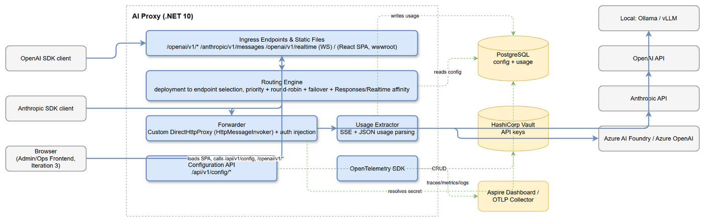
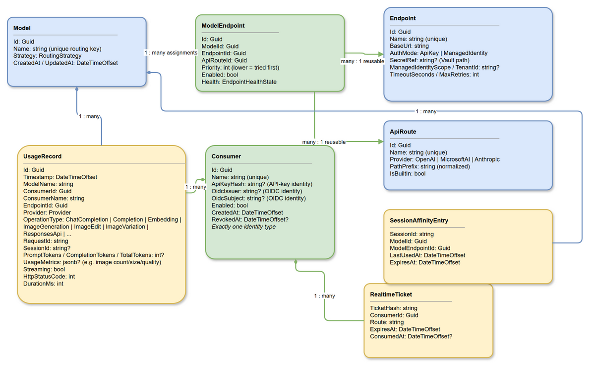
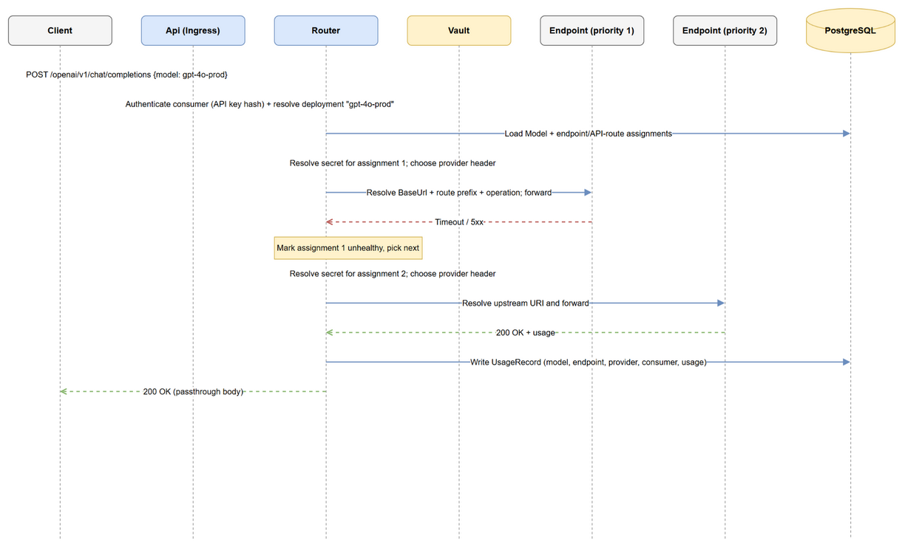
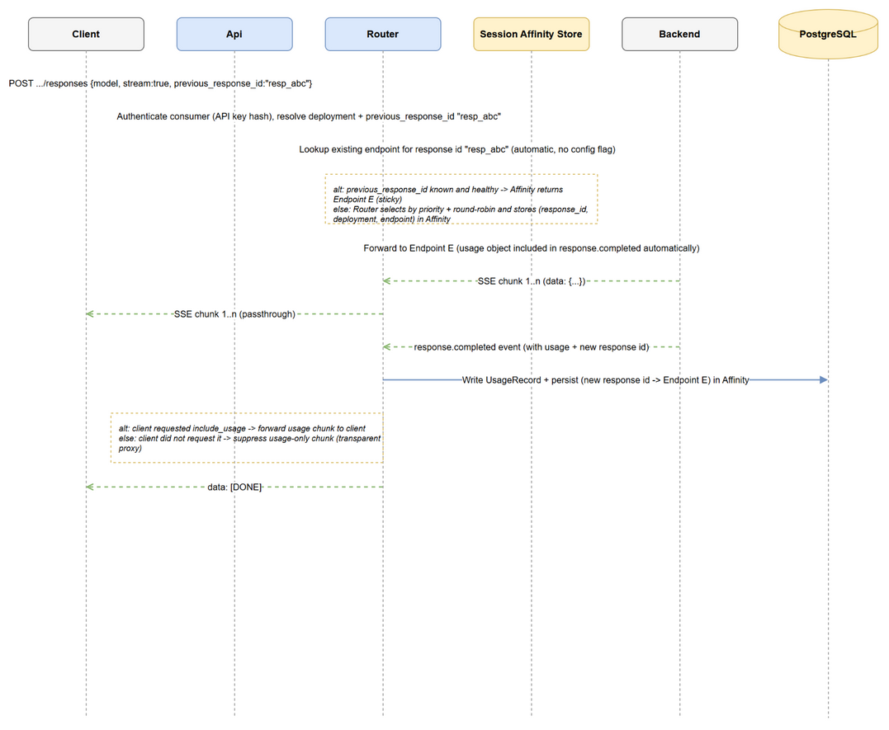
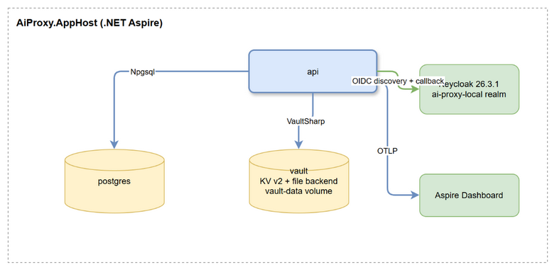

# AI Proxy — Architecture (Iteration 1)

## 1. Purpose

This project is a clean-slate rewrite of [azureholic/ai-proxy](https://github.com/azureholic/ai-proxy), keeping the same
core principle — **a self-hosted reverse proxy that sits in front of one or more LLM inference endpoints, centralizes
authentication/secrets, tracks token usage for chargeback, and adds resiliency (retry/failover)** — but generalized so
it is not tied to Azure:

- The original proxied only Azure OpenAI, logged usage to Log Analytics, and relied on Azure Managed Identity.
- This version proxies **OpenAI-compatible** and **Anthropic** APIs, can call model endpoints hosted **anywhere**
  (local, OpenAI, Anthropic, Azure AI Foundry, self-hosted vLLM/Ollama, ...), stores configuration and usage in
  **PostgreSQL**, stores secrets in a **self-hosted secret store**, and emits **OpenTelemetry** traces/metrics/logs.
- Azure Managed Identity remains as *one of several* supported authentication modes for an endpoint (useful when the
  proxy itself runs in Azure and the target is Azure AI Foundry / Azure OpenAI), but it is optional, per-endpoint
  configuration — the solution itself has no hard Azure dependency.

## 2. Scope of Iteration 1

### In scope (maps to the numbered requirements)

| # | Requirement | Covered by |
|---|---|---|
| 1 | No Azure dependencies | PostgreSQL + self-hosted Vault + container runtime; Azure SDK only loaded as an optional, per-endpoint credential provider |
| 2 | OpenAI API support | `/openai/v1/...` ingress: chat completions, completions, embeddings, images (generations/edits/variations), the **Responses API** (`/responses`, stateful via `previous_response_id`); OpenAI-compatible request/response passthrough, extensible to further operation types via a pluggable usage extractor (§4, §10) |
| 3 | Anthropic API support | `/anthropic/v1/messages` ingress, Anthropic Messages API passthrough (multimodal image input inside a message already works unmodified — passthrough doesn't care about content shape) |
| 4 | Container + PostgreSQL datastore | Docker/Aspire container topology; EF Core + Npgsql |
| 4.1 | ... for configuration | `Models` / `Endpoints` / `Consumers` tables, config REST API |
| 4.2 | ... for logging (token usage) | `UsageRecords` table, written per request/stream, attributed to a `Consumer` resolved from the caller's API key |
| 5 | OpenTelemetry (traces, logs, metrics) | OTLP exporter → Aspire dashboard locally, OTLP collector in prod |
| 6 | Configuration | see §7 |
| 6.1 | Model name | `Model.Name` (routing key) |
| 6.2 | 1+ endpoints, priority + failover | `ModelEndpoint.Priority`, `EndpointSelector` (Domain): lowest-priority tier first, round-robin across assignments that share a priority, failover on `429`/`5xx` (Iteration 2) |
| 6.3 | Sticky sessions for stateful calls | **Automatic, protocol-inherent affinity only** — no config flag (Iteration 2). Responses API: `previous_response_id`-keyed affinity (`ISessionAffinityStore`, persisted in Postgres). Realtime API: the WebSocket connection itself is the affinity (§6.5/§9) |
| 6.4 | API key vs Managed Identity per endpoint | `Endpoint.AuthMode` + `ICredentialProvider` strategy |
| 6.5 | Configuration REST API | `/api/v1/config/*` CRUD endpoints, incl. `Consumer` (API key) management |
| 7 | Secure API key storage, container-based | HashiCorp Vault (OSS) container, KV v2 engine |
| 8 | Streaming + forced usage accounting | Force `stream_options.include_usage` / Anthropic usage event; capture server-side regardless of client request |

### Explicit non-goals for Iteration 1 (future work)

- Cross-protocol translation (e.g. client speaks OpenAI schema, backend is Anthropic-only). Iteration 1 requires the
  ingress protocol family to match the backend protocol family for a given deployment.
- Multi-tenant RBAC / OAuth2 for the configuration API (a single admin API key is used as a placeholder).
- Rate limiting / quota enforcement per client.
- Response caching / semantic caching.
- Admin UI (only REST API + OpenAPI).
- Automatic secret rotation workflows (Vault supports it; wiring it up is future work).
- Realtime (voice) API — added in Iteration 2 (§6.5/§9); out of scope for Iteration 1.
- Admin UI — added in Iteration 3 (§19) as a small ops/config frontend; still no end-user-facing UI, and the
  frontend's own auth remains a `sessionStorage`-based stand-in, not a real login system (§19).

## 3. High-Level Architecture



*Source: [diagrams/01-high-level-architecture.drawio](diagrams/01-high-level-architecture.drawio)*

## 4. Solution Structure (Clean Architecture)

Dependencies point **inward**. Nothing in `Domain` or `Application` references ASP.NET Core, EF Core,
OpenTelemetry — those are all `Infrastructure` concerns wired up in `Api` (composition root) and `AppHost`.

```
ai-proxy/
├── src/
│   ├── AiProxy.Domain/            # Entities, value objects, domain events, repository interfaces (ports)
│   ├── AiProxy.Application/       # Use cases (CQRS-ish handlers), DTOs, validation, application-level interfaces
│   ├── AiProxy.Infrastructure/    # EF Core + Npgsql, Vault client, direct-HTTP routing/forwarding,
│   │                              # HTTP forwarding, OpenTelemetry instrumentation, background jobs
│   ├── AiProxy.Api/                # ASP.NET Core minimal API host, endpoint mapping, middleware, composition root
│   │                                # (wwwroot/ — Iteration 3 frontend build output, gitignored, see §19)
│   ├── AiProxy.Web/                 # React + TypeScript + FluentUI admin/ops frontend (Iteration 3, §19)
│   ├── AiProxy.ServiceDefaults/    # Aspire shared service defaults (OTel, health checks, resilience defaults)
│   └── AiProxy.AppHost/            # .NET Aspire AppHost — orchestrates Api, Postgres, Vault, Aspire Dashboard
├── tests/
│   ├── AiProxy.Domain.Tests/               # Unit tests, no I/O
│   ├── AiProxy.Application.Tests/          # Unit tests w/ mocked ports
│   ├── AiProxy.Infrastructure.Tests/       # Integration tests — Testcontainers (Postgres, Vault)
│   ├── AiProxy.Api.Tests/                  # Integration tests — WebApplicationFactory + WireMock.Net fake backends
│   └── AiProxy.ArchitectureTests/          # NetArchTest rules enforcing the dependency graph above
├── logs/                # Runtime debug logs (Serilog file sink) — gitignored, kept via .gitkeep
├── test-results/         # dotnet test TRX/coverage output — gitignored, kept via .gitkeep
├── docker-compose.yml    # Postgres + Vault + Api for non-Aspire container runs
└── specs/
    ├── architecture/
    └── iterations/
```

### Layer responsibilities

- **Domain** — `Model`, `Endpoint`, `ApiRoute`, `ModelEndpoint`, `UsageRecord`, `SessionAffinityEntry`,
  `Consumer`, value objects
  (`Provider`, `AuthMode`, `RoutingStrategy`, `ModelCapability` — Chat, ImageGeneration, Realtime,
  SpeechToText, TextToSpeech; `OperationType` — ChatCompletion, Completion, Embedding, ImageGeneration,
  ImageEdit, ImageVariation, ResponsesApi, `RealtimeVoice` (Iteration 2), SpeechToText, TextToSpeech),
  `EndpointSelector` (the priority + round-robin selection algorithm — Iteration 2 rework, see §9), domain
  invariants (a `UsageRecord` must always reference a valid `Consumer`; token fields are optional but at least
  one usage signal — tokens or `UsageMetrics` — must be present). `Endpoint` is a reusable aggregate containing
  only target connectivity and credential configuration. `ApiRoute` is a reusable aggregate containing a display
  name, closed `Provider` (`OpenAI`, `MicrosoftAI`, or `Anthropic`), normalized upstream path prefix, and whether
  it originated as a built-in route. `ModelEndpoint` assigns one endpoint and one API route to a model and owns
  routing-specific priority, enabled state, and health. An assignment has its own stable identifier and is unique
  by `(ModelId, EndpointId, ApiRouteId)`, allowing one endpoint to be reused through multiple API routes on the
  same model. Assignments on the same model sharing a `Priority`
  intentionally round-robin together (Iteration 2) rather than violating a constraint. A
  deployment with zero or no *enabled* endpoints is a valid domain state (`Model.HasUsableEndpoint`
  reports it) — routing simply fails with `NoHealthyEndpoint` for it at request time; it's not a
  constructor-enforced invariant.
- **Application** — ports: `IModelRepository`, `IApiRouteRepository`, `IConsumerRepository`, `ISessionAffinityStore`,
  `IUsageRecordRepository`, `ISecretResolver`, `ICredentialProvider`, `IApiKeyHasher`, `IApiKeyGenerator`,
  `IConsumerAuthenticator`, `IEndpointHealthTracker`, `IEndpointRoundRobinCounter` (Iteration 2), `IUsageExtractor`
  (one implementation per `Provider` + `OperationType` combination, resolved via `IUsageExtractorResolver`);
  command/query handlers for configuration CRUD and usage queries; validation (FluentValidation).
- **Infrastructure** — implements all ports: `AiProxyDbContext` (EF Core/Npgsql), `VaultSecretResolver`
  (VaultSharp), `ApiKeyCredentialProvider` / `ManagedIdentityCredentialProvider`, `ProxyRoutingService` +
  `DirectHttpProxy` + `SseStreamRelay` (routing/forwarding/streaming — see §9 for why this isn't built on YARP),
  `RealtimeProxyService` (WebSocket proxy for the Realtime API, Iteration 2, §6.5/§9),
  `EndpointRoundRobinCounter` (Iteration 2), per-`(Provider, OperationType)` `IUsageExtractor` implementations
  (`OpenAiStyleTokenUsageExtractor`, `AnthropicChatUsageExtractor`, `ImageUsageExtractor`,
  `ResponsesUsageExtractor`), `AiProxyMetrics`/`AiProxyActivitySource` (OpenTelemetry).
- **Api** — maps ingress routes (`/openai/v1/*`, `/anthropic/v1/messages`, `/openai/v1/realtime` WebSocket —
  Iteration 2, and `/openai/v1/audio/*` — Iteration 9), configuration routes (`/api/v1/config/*`), health
  endpoints (`/health/live`, `/health/ready`),
  OpenAPI, DI composition. Also serves the Iteration 3 frontend's static files from `wwwroot` and its SPA
  fallback route (§19) — this is composition-root wiring, not a new architectural layer.
- **ServiceDefaults / AppHost** — Aspire wiring for local development: starts Postgres, Vault, the Api, and the
  Aspire dashboard, and injects OTLP endpoint + connection strings via service discovery.
- **Web** (Iteration 3) — a separate, independently-buildable React/TypeScript project with no dependency on
  any other project in the solution; it only talks to `Api` over HTTP/WebSocket, exactly like any other API
  consumer. See §19 for the full design.

## 5. Domain Model



*Source: [diagrams/02-domain-model.drawio](diagrams/02-domain-model.drawio)*

Iteration 9 gives each `Model` a non-empty set of administrator-managed `ModelCapability` values. Capabilities
describe which Playground experiences should offer the model; they are not a complete provider-operation support
matrix and do not block direct ingress for existing operations such as embeddings or Responses API. The closed
values are `Chat`, `ImageGeneration`, `Realtime`, `SpeechToText`, and `TextToSpeech`. Speech is split because a
transcription model and a synthesis model are not interchangeable. Persistence uses a model-owned
`model_capabilities` relation keyed by `(model_id, capability)`. Deleting a model cascades to its capabilities.
Existing models are backfilled with Chat, ImageGeneration, and Realtime to preserve pre-upgrade Playground
visibility; speech capabilities always require explicit administrator selection.

## 6. Request Flow

### 6.1 Non-streaming chat completion, with failover



*Source: [diagrams/03-sequence-non-streaming-failover.drawio](diagrams/03-sequence-non-streaming-failover.drawio)*

### 6.2 Streaming Responses API call, with automatic affinity, forced usage capture



*Source: [diagrams/04-sequence-streaming-sticky-usage.drawio](diagrams/04-sequence-streaming-sticky-usage.drawio)*

> **Note:** this diagram illustrates the Responses API's automatic `previous_response_id` affinity (§6.4/§9) —
> the only streaming operation type that also carries cross-request affinity. Plain chat completions streaming
> looks the same minus the affinity lookup/persist steps (Iteration 2 removed the generic session-id sticky
> mechanism entirely — every non-Responses/Realtime request just uses priority + round-robin, §9).

### 6.3 Non-token operations (e.g. image generation)

Embeddings and Images requests flow through the exact same ingress → routing → forwarder pipeline as chat
completions — deployment resolution still peeks the `model` field (Images API requests carry one too), and
failover/sticky-session behavior is identical. The only thing that changes per operation type is **which**
`IUsageExtractor` is invoked: chat completions and embeddings extract `prompt_tokens`/`completion_tokens`/
`total_tokens`; image generation/edit/variation extract whatever billing signal the response actually contains
(e.g. image count, size, quality) into `UsageRecord.UsageMetrics`, since most Images API responses don't report
token usage. Image requests are treated as non-streaming request/response for Iteration 1 (see §10).

### 6.4 Responses API (stateful chaining via `previous_response_id`)

The Responses API (`/openai/v1/responses`) flows through the same pipeline too, but it's the one OpenAI operation
that is stateful *by OpenAI's own design*: unless a caller passes `store: false`, OpenAI persists each response
server-side, and a follow-up turn references it via `previous_response_id` instead of resending prior messages.
That id only resolves on the endpoint that originally created it, so it's treated as an implicit sticky-session
key (see §9) — this affinity is automatic and protocol-inherent, not a client-supplied session identifier or a
deployment-level config flag (Iteration 2 removed the generic `session`/`X-Session-Id` mechanism entirely — see
the note in §9). Usage is extracted the same way as any other operation, just via the Responses-specific
`IUsageExtractor` (§10).

### 6.5 Realtime (voice) API — WebSocket proxy (Iteration 2)

`GET /openai/v1/realtime?model={deploymentName}` is not a request/response call — the client upgrades to a
WebSocket and the connection stays open for the duration of a voice session. `RealtimeProxyService` resolves the
`Model` from the `model` **query string** (there is no request body to peek at handshake time),
picks an endpoint via the same priority + round-robin `EndpointSelector` used for HTTP ingress, resolves its
credential, and opens an outbound `ClientWebSocket` to the backend before accepting the inbound upgrade. Once
both legs are connected, frames are relayed bidirectionally, byte-for-byte, until either side closes — see §9
for the failover and close-propagation details. Iteration 2 targets the **OpenAI Realtime API** only
(`wss://.../v1/realtime?model=...`, `Authorization: Bearer` auth); Azure OpenAI Realtime and generic/self-hosted
WebSocket backends are deferred, as is usage/token capture for this operation type (`OperationType.RealtimeVoice`
exists for future use, but no `IUsageExtractor` reads a Realtime session yet).

### 6.6 Request/response speech (Iteration 9)

`POST /openai/v1/audio/transcriptions` accepts OpenAI-compatible multipart form data. The router buffers the raw
request bytes once, reads the `model` form field for deployment resolution, and forwards those original bytes with
the original multipart content type and boundary on every bounded retry. It never reconstructs, persists, or logs
the uploaded audio. Malformed multipart payloads, a missing model field, and requests over the configured server
request-body limit fail locally before endpoint or credential resolution.

`POST /openai/v1/audio/speech` uses the existing JSON `model` peek and forwards the request unchanged. Successful
synthesis responses are arbitrary binary audio, so the winning response is streamed directly with its upstream
status and end-to-end content headers rather than decoded as UTF-8 or inspected as JSON. Failed retriable responses
are still buffered for retry/failover and first-error replay. OpenAI and Microsoft AI routes use
`/audio/transcriptions` and `/audio/speech`; unsupported provider/operation pairs fail locally. Usage is captured
only when the provider returns a real token or non-token usage signal; the proxy does not invent billing values.

## 7. Configuration & Persistence

### 7.1 PostgreSQL schema (initial)

| Table | Purpose | Key columns |
|---|---|---|
| `models` | Routing key + policy | `id`, `name` (unique), `strategy` |
| `model_capabilities` | Model-owned Playground discovery metadata | `model_id`, `capability`; composite primary key, cascades with model |
| `endpoints` | Reusable backend target and credential configuration | `id`, `name` (unique), `base_url`, `auth_mode`, `secret_ref`, `managed_identity_scope`, `managed_identity_tenant_id?`, `timeout_seconds`, `max_retries` |
| `api_routes` | Reusable provider API surfaces | `id`, `name` (unique), `provider`, `path_prefix`, `is_built_in`; `(provider, path_prefix)` unique |
| `model_endpoints` | Model-to-endpoint/API-route assignments | `id`, `model_id`, `endpoint_id`, `api_route_id`, `priority`, `enabled`, `health`; `(model_id, endpoint_id, api_route_id)` unique |
| `consumers` | Callers allowed to invoke the proxy | `id`, `name` (unique), `api_key_hash`, `enabled`, `created_at`, `revoked_at` |
| `usage_records` | Usage log (append-only) | `id`, `timestamp`, `model_name`, `consumer_id`, `consumer_name`, `endpoint_id`, `operation_type`, `prompt_tokens?`, `completion_tokens?`, `total_tokens?`, `usage_metrics` (jsonb), `streaming`, `status_code`, `duration_ms` |
| `session_affinity` | Responses API affinity map | `session_id`, `model_id`, `model_endpoint_id`, `endpoint_id`, `expires_at` |
| `__ef_migrations_history` | EF Core migrations | standard |

Access via EF Core + Npgsql, code-first migrations applied before the API begins serving requests. `usage_records` is append-only and indexed on
`(model_name, timestamp)` and `(consumer_id, timestamp)` for chargeback queries per deployment and per
consumer. `consumers.api_key_hash` stores a salted one-way hash (e.g. HMAC-SHA256 with a server-side pepper) of the
consumer's inbound API key — never the key itself — so a Postgres read compromise does not leak usable credentials.
`prompt_tokens`/`completion_tokens`/`total_tokens` are nullable — only token-based operations (chat completions,
completions, embeddings) populate them; other operation types (e.g. image generation) populate the flexible
`usage_metrics` jsonb column instead, so new modalities can report whatever billing signal they have without a
schema migration.

`ApiRoute.Name` is compared case-insensitively for uniqueness. `PathPrefix` must be a relative absolute-path
component: it starts with exactly one `/`, has no trailing slash (except `/` itself), contains no query or
fragment, and cannot be an absolute URI. The aggregate normalizes repeated boundary slashes before persistence.
The closed provider vocabulary makes supported behavior explicit and prevents an administrator from selecting a
provider for which credential placement, mutation, and usage semantics are unknown. API routes cannot be deleted
while assigned. Built-in routes are migration-owned and carry stable identifiers, but remain editable and may be
deleted when unassigned; `IsBuiltIn` records their origin and startup never overwrites administrator changes.

The migration seeds these built-in routes deterministically: Foundry OpenAI (`OpenAI`, `/openai/v1`), Microsoft
AI (`MicrosoftAI`, `/mai/v1`), Anthropic (`Anthropic`, `/anthropic/v1`), and Native OpenAI (`OpenAI`, `/v1`).
Existing assignments are backfilled to the route matching their former API family without changing priority,
enabled state, health, or endpoint credentials.

> **Implementation note:** the originally-planned in-memory config cache (with in-process change-token
> invalidation on writes) was **not** built in Iteration 1 — `IModelRepository`/`IConsumerRepository`
> hit Postgres directly on every call, including once per ingress request for deployment resolution. This is a
> known follow-up (a short-TTL cache, invalidated on `/api/v1/config/*` writes, would cut a DB round-trip off
> the hot path) rather than a documented-and-implemented feature — flagged here so the diagrams/text don't
> overstate what exists today.

### 7.2 Configuration REST API (`/api/v1/config`)

| Method | Route | Purpose |
|---|---|---|
| GET | `/api/v1/config/models` | List deployments (with endpoints) |
| GET | `/api/v1/config/models/{name}` | Get one deployment |
| POST | `/api/v1/config/models` | Create deployment |
| PUT | `/api/v1/config/models/{name}` | Update deployment (policy fields) |
| DELETE | `/api/v1/config/models/{name}` | Delete deployment (cascades assignments, not reusable endpoints) |
| POST | `/api/v1/config/models/{name}/endpoints` | Assign an existing endpoint with priority and enabled state |
| PUT | `/api/v1/config/models/{name}/endpoints/{id}` | Update assignment priority and enabled state |
| DELETE | `/api/v1/config/models/{name}/endpoints/{id}` | Remove an endpoint assignment |
| GET | `/api/v1/config/endpoints` | List reusable endpoints |
| GET | `/api/v1/config/endpoints/{id}` | Get one reusable endpoint |
| POST | `/api/v1/config/endpoints` | Create a reusable endpoint; API-key plaintext is written to Vault |
| PUT | `/api/v1/config/endpoints/{id}` | Update reusable target/auth configuration |
| DELETE | `/api/v1/config/endpoints/{id}` | Delete an unassigned endpoint; returns conflict while assigned |
| PUT | `/api/v1/config/endpoints/{id}/secret` | Set/replace the API key (writes to Vault, never returned by GET) |
| GET | `/api/v1/config/api-routes` | List reusable API routes |
| GET | `/api/v1/config/api-routes/{id}` | Get one reusable API route |
| POST | `/api/v1/config/api-routes` | Create a reusable API route |
| PUT | `/api/v1/config/api-routes/{id}` | Update a reusable API route |
| DELETE | `/api/v1/config/api-routes/{id}` | Delete an unassigned API route; returns conflict while assigned |
| GET | `/api/v1/config/consumers` | List consumers (name, enabled, created/revoked — never the key or its hash) |
| POST | `/api/v1/config/consumers` | Create a consumer; response includes the **plaintext API key exactly once** — only its hash is persisted |
| PUT | `/api/v1/config/consumers/{name}/rotate` | Rotate a consumer's API key; returns the new plaintext key once, invalidates the old one |
| DELETE | `/api/v1/config/consumers/{name}` | Revoke a consumer (soft delete via `revoked_at`; historical `usage_records` are preserved) |
| GET | `/api/v1/usage` | Query usage records (filter by deployment, consumer, date range) |

All write routes require an admin API key (`X-Admin-Api-Key` header, validated against a hash stored in Vault) for
Iteration 1. Requests/responses are validated with FluentValidation; secrets are **write-only** — no GET ever returns
key material, only the `secret_ref` path (endpoints) or consumer metadata without the key/hash (consumers).

> **Implementation note (Phase 7):** admin auth (`AdminAuthEndpointFilter`) is applied to the *entire*
> `/api/v1/config/*` and `/api/v1/usage` surface, not just write routes as originally scoped above — deployment
> topology (GET) and per-consumer usage/token figures (`GET /api/v1/usage`) are both sensitive enough to keep
> behind admin auth even for reads, per OWASP API3/API5 (broken object/function-level authorization). Ingress
> inference routes require a separate, per-caller `X-Api-Key` header resolved to a `Consumer` via
> `ConsumerAuthEndpointFilter` + `IConsumerAuthenticator`; the resolved identity is stashed in
> `HttpContext.Items` for `ProxyRoutingService`'s usage capture to read. The admin key itself, like the
> Consumer-key pepper, is auto-provisioned into Vault on first run (logged once, since there is no
> chicken-and-egg config API to create it through) — see `AdminApiKeyAuthenticator`.

## 8. Secrets Management

**HashiCorp Vault (OSS)** runs as a container alongside the proxy (dev mode locally via Aspire; `file` or
`raft` storage backend in real deployments). API keys are stored under a **KV v2** engine at
`secret/ai-proxy/endpoints/{endpointId}`. The proxy authenticates to Vault using **AppRole** (role id + wrapped
secret id supplied via environment/orchestrator secret, never committed) — for local Aspire runs, dev-mode Vault
with a well-known root token confined to the dev environment is acceptable.

- `Endpoint.SecretRef` in Postgres stores only the Vault **path**, never the secret value.
- `ManagedIdentity`-mode endpoints have no Vault entry; the proxy instead acquires an Entra ID access token via
  `Azure.Identity` (`DefaultAzureCredential`/`ManagedIdentityCredential`) scoped to the target resource
  (e.g. Azure AI Foundry / Cognitive Services scope) and attaches it as a bearer token. An endpoint may also
  specify `ManagedIdentityTenantId` to request the token from the target resource's Entra tenant; when omitted,
  the credential chain's default tenant behavior is preserved. The tenant ID is configuration, not secret
  material. This is the **only** place the solution touches an Azure SDK, and it's opt-in per endpoint.
- Resolved secrets are cached in-memory with a short TTL (e.g. 5 minutes) to avoid a Vault round trip per request,
  and are never logged (Serilog destructuring policies + explicit redaction for auth headers).
- **Scope note**: Vault holds secrets the proxy must *present outbound* (endpoint credentials, the admin key hash).
  Inbound **Consumer** API keys (see the domain model in §5 and authentication in §13) are a different concern —
  the proxy only ever needs to *verify* them, never retrieve or replay them — so they are stored as a salted
  one-way hash directly in `consumers.api_key_hash` (Postgres), avoiding a Vault round trip on every single
  ingress request. The **pepper** (a server-wide secret mixed into that hash to resist offline cracking if the
  `consumers` table ever leaks) is itself a real secret the app must retrieve, so it lives in Vault at
  `secret/ai-proxy/consumer-key-pepper`, read once at startup and cached in memory — not the individual consumer
  keys, just this single shared value.

## 9. Routing & Failover

> **Implementation note:** the original plan was to build this on YARP's declarative `IProxyConfigProvider`/
> cluster/session-affinity model. During Phase 5 implementation this was replaced with a custom
> `DirectHttpProxy` + `ProxyRoutingService` (still using `Yarp.ReverseProxy`'s low-level building blocks was
> considered, but ultimately not used) for two reasons, confirmed empirically: (1) destination selection here
> depends on the request *body* (`model`, session id, `previous_response_id`) and domain rules, not a static
> route table; (2) YARP's `IHttpForwarder` commits response status/headers to the client as soon as they
> arrive from upstream, which makes "inspect the response, then decide whether to retry on the next endpoint"
> impossible when reusing the same `HttpContext` across attempts. Routing/failover/affinity/retry are
> therefore all handled directly in `AiProxy.Infrastructure.Routing`, issuing each attempt via a raw
> `HttpMessageInvoker` and only copying the accepted response onto `HttpContext.Response` once a winning
> attempt is chosen (or retries are exhausted).

- **Deployment resolution**: the ingress endpoint buffers and peeks the request body (`model` field for OpenAI
  schema, `model` field for Anthropic schema) to determine the target `Model` before forwarding —
  this is the one place the proxy must buffer the body, and it's covered by a dedicated integration test. The
  same `model`-field peek covers every OpenAI-compatible operation type (chat completions, completions,
  embeddings, images) since they all carry a `model` field — no per-operation-type routing logic is needed.
- **Upstream route resolution (Iteration 7)**: the selected `ModelEndpoint` supplies both its physical `Endpoint`
  and `ApiRoute`. Before credentials are resolved or any network call is made, the provider adapter validates that
  the ingress `OperationType` is supported and resolves its operation suffix. The target URI is composed as
  `Endpoint.BaseUrl + ApiRoute.PathPrefix + operation suffix + incoming query`, with exactly one slash at each
  boundary. The proxy ingress prefix is never forwarded. OpenAI and Microsoft AI support chat completions,
  completions, embeddings, image generation/edit/variation, and Responses API; OpenAI additionally supports
  Realtime. Anthropic supports messages through `ChatCompletion` only. Unsupported combinations fail locally
  with a configuration/routing error before an upstream request is sent.
- **Provider adapter boundary (Iteration 7)**: adapters own operation suffixes, API-key header placement
  (`Authorization: Bearer` for OpenAI, `api-key` for Microsoft AI, `x-api-key` for Anthropic), provider-specific
  request mutation, and usage-extractor selection. Managed identity still uses bearer authentication from the
  endpoint's credential configuration. Payloads and responses remain protocol passthrough; OpenAI-compatible and
  Anthropic schemas are never cross-translated.
- **Priority + round-robin (Iteration 2)**: assigned endpoints are grouped by `ModelEndpoint.Priority`; `EndpointSelector`
  (Domain) narrows to the healthy/enabled candidates, picks the **lowest surviving priority number**, and, if
  more than one endpoint shares that priority, **round-robins** across them using a per-request counter
  (`IEndpointRoundRobinCounter`, snapshotted once per incoming request/connection so a single request's
  failover retries move deterministically through the tier instead of re-rolling on every retry). A single
  endpoint, or a deployment where every endpoint has a distinct priority, behaves exactly like strict
  priority-order failover — round-robin only has a visible effect when two or more endpoints share a priority.
  Two endpoints sharing a priority is intentional configuration (ties round-robin together), not an error.
- **Failover triggers**: a backend response of `429` (rate limited) or any `5xx`, or a transport-level failure
  (timeout, connection refused), marks the endpoint unhealthy for this request (`IEndpointHealthTracker`) and
  the next candidate in the round-robin tier — or the next priority tier if the current one is exhausted — is
  tried, bounded by the deployment's total endpoint count. `429` was added in Iteration 2: it's the single most
  common real-world reason to want failover, and treating it identically to `5xx` means a rate-limited primary
  endpoint no longer fails every in-flight request while a secondary endpoint sits idle.
- **Sticky sessions — automatic and protocol-inherent only (Iteration 2)**: there is no deployment-level sticky
  session config flag and no generic client-supplied `session`/`X-Session-Id` mechanism — both existed in
  Iteration 1 and were removed. Every request that isn't inherently stateful just uses priority + round-robin
  above, freely. Two operation types carry their own built-in affinity instead:
  - **Responses API** (§6.4): the affinity key is the caller's `previous_response_id`. The affinity map is
    persisted in `session_affinity` (Postgres) rather than only in-memory, so the "one endpoint per stateful
    chain" guarantee survives proxy restarts/multiple replicas. It stores the stable model-endpoint assignment
    identifier as well as the physical endpoint identifier, pinning the exact endpoint and API route. If the
    affinity-selected endpoint becomes
    unhealthy, the documented failure policy applies (fail the request with a clear error rather than silently
    rerouting a stateful session — confirmed unsafe and covered by an integration test). An
    unrecognized/expired affinity key (no matching row) is *not* an error — the request simply falls back to
    normal (non-sticky) routing.
  - **Realtime API** (§6.5): the WebSocket connection itself *is* the affinity — one endpoint is selected once,
    for the connection's whole lifetime, via the same priority + round-robin `EndpointSelector`. Failover only
    applies to the **handshake**: if the outbound `ClientWebSocket.ConnectAsync` to the chosen endpoint fails
    before any client data has flowed, `RealtimeProxyService` marks that endpoint unhealthy and tries the next
    priority/round-robin candidate. Once the connection is established, a drop is a client-visible error —
    silently reconnecting to a different backend mid-call would lose in-flight audio/session state, so this is
    a deliberate non-goal, not a gap. On a graceful close from either side, the proxy acknowledges the close
    back to the sender and propagates the close to the other leg, so neither side is left hanging.
- **Responses API chaining**: the Responses API is stateful by default (OpenAI persists each response server-side
  unless the caller sets `store: false`), and a follow-up call references the prior turn via
  `previous_response_id` — that id only resolves on the endpoint that created it. So whenever a `/responses`
  call completes, the proxy reads the response's own `id` field and writes a `session_affinity` row
  (`session_id` = that response id → the model-endpoint assignment used); the *next* call that sends `previous_response_id`
  looks itself up the same way a client session id would. No new storage concept is needed —
  `session_affinity.session_id` is just an opaque affinity key, whether it came from a client or from an
  OpenAI-issued response id. If the client sets `store: false`, there is no chain to preserve and no affinity
  row is written.
- **Retries**: bounded per-endpoint retry (`Endpoint.MaxRetries`) with jittered backoff, issued as direct
  `HttpMessageInvoker` calls (not `Microsoft.Extensions.Http.Resilience`/Polly — the retry decision needs to
  inspect the upstream response *before* anything is written to the client, which a `DelegatingHandler`-based
  resilience pipeline around a single forwarded call doesn't give us control over) before failing over to the
  next priority.
- **Exhausted failover — client sees the first endpoint's real error**: if every endpoint/tier is tried and
  none succeed, the client does **not** get a generic 503 that hides what actually happened. `ProxyRoutingService`
  buffers the response (status, headers, body) from the *first* endpoint attempted this request — typically
  priority 1 — the moment it fails, and replays that snapshot verbatim once failover is exhausted, even if a
  later endpoint failed with a *different* status. This matters most for `429`: the client gets the original
  `Retry-After`/rate-limit headers back and can back off correctly, instead of a synthetic error that gives no
  indication of when to retry. (The one exception is the sticky-endpoint-failure path in the bullet above —
  that intentionally stays a generic error, not a replayed upstream body, per the "fail fast, don't mask a
  stateful-session failure" policy.) A request that fails before any endpoint is even attempted (e.g. the
  deployment has zero enabled endpoints) has no upstream response to replay and still gets the generic
  `RoutingFailureReason`-mapped error.
- **Multiple AI Proxy replicas behind a load balancer / ingress controller**: the proxy itself is stateless
  across requests — nothing above depends on which replica handles a given call, so horizontal scaling needs no
  special ingress-level session affinity/sticky routing to the *same AI Proxy instance*:
  - **Responses API affinity** is keyed by `previous_response_id` and persisted in `session_affinity`
    (Postgres, shared across replicas) — whichever replica receives the follow-up call looks up the same row
    and pins to the same backend endpoint. This is exactly why it's a database table and not an in-process
    cache (§7.1).
  - **Realtime API affinity** is the WebSocket connection itself, which is inherently pinned to whichever
    single replica accepted the upgrade for as long as the TCP connection stays open — this is a property of
    how L7 ingress proxying works (the ingress doesn't/can't migrate an established WebSocket to a different
    backend pod mid-connection), not something the application has to implement or configure.
  - **`IEndpointRoundRobinCounter`/`IEndpointHealthTracker`**, by contrast, *are* per-replica in-memory state
    (a `ConcurrentDictionary`, not persisted) — each replica keeps its own round-robin cursor and passive
    health view. This is an accepted trade-off, not a bug: round-robin fairness only needs to be "even in
    aggregate", which holds as long as the ingress spreads requests across replicas reasonably (each replica
    independently cycling through the same priority tier still balances out overall); it does not need to be a
    single globally-synchronized counter. `IEndpointHealthTracker`'s per-replica view isn't actually consulted
    by `EndpointSelector` for candidate filtering today — the only health signal that drives same-request
    failover is the request-scoped `excludedEndpointIds` set — so replica-local health state has no correctness
    impact either way; it's tracked for future use (e.g. an admin health-status view), not selection.

  Route selection does not otherwise change retry/failover semantics. Health and same-request exclusion remain
  keyed to the physical endpoint because connectivity and credentials are endpoint concerns; a failed host is not
  retried immediately through another route. Telemetry and usage attribution include the selected provider and API
  route while retaining endpoint and model labels.

## 10. Streaming & Usage Capture (8)

- Usage extraction is **pluggable per provider and operation type** via
  `IUsageExtractor`/`IUsageExtractorResolver` (§4), so
  adding a new modality later (e.g. audio) only means adding a new extractor implementation, not changing the
  ingress/routing/forwarding pipeline.
- For OpenAI-family **chat completions and completions** requests, the proxy always sets
  `"stream_options": {"include_usage": true}` on the outbound request when `stream: true`, regardless of
  whether the client set it (`OutboundBodyMutator`). The **Responses API** always includes a `usage` object on
  the completed response (in the terminal `response.completed` SSE event when streaming, or directly in the
  JSON body otherwise) — no request mutation is needed to force it there.
- For Anthropic-family requests, usage is included in the `message_start` and terminal `message_delta` events by
  default; the proxy simply parses these — no request mutation needed there.
- A streaming response interceptor (`SseStreamRelay`) reads the SSE byte stream as it flows through,
  splitting on blank-line-delimited event blocks, parsing `data: {...}` JSON payloads to detect the usage-bearing
  event (the specific event name/shape depends on the operation type — chat completions' final chunk, or the
  Responses API's `response.completed` event with an `input_tokens`/`output_tokens`/`total_tokens` usage
  object), recording it, and otherwise passing bytes through untouched (no buffering of the whole stream — must
  preserve time-to-first-byte).
- If the **client's original request did not** ask for usage (`include_usage` absent for OpenAI, or an Anthropic
  client that doesn't expect a usage-only trailing event), the proxy removes the *injected* usage-only chunk from
  what is sent downstream, so the client-visible stream is unchanged relative to calling the backend directly.
  When the client **did** ask for it, the chunk is passed through unmodified.
- Non-streaming responses (embeddings, images, and any chat/completions call without `stream: true`) are simpler:
  the JSON body already contains the relevant usage signal — a token-style `usage` object, or an operation-specific
  field set for images; the matching `IUsageExtractor` parses it and the original body is forwarded unmodified.
- Usage is written to `usage_records` asynchronously (fire-and-forget with a bounded channel + background
  writer) so it never adds latency to the response path; failures to persist usage are logged, not surfaced to
  the client.

## 11. Observability (OpenTelemetry)

- **Traces**: one root `Activity` per ingress request (`ai_proxy.request`), child spans for deployment
  resolution, secret resolution, backend call, and usage extraction. Standard `http.client`/`http.server`
  auto-instrumentation via `OpenTelemetry.Instrumentation.AspNetCore`/`.Http`.
- **Metrics**: custom `Meter("AiProxy")` with instruments:
  - `ai_proxy.requests.count` (tags: deployment, api_family, endpoint, status)
  - `ai_proxy.tokens.prompt` / `ai_proxy.tokens.completion` / `ai_proxy.tokens.total` (tags: deployment, endpoint)
  - `ai_proxy.request.duration` (histogram, tags as above)
  - `ai_proxy.failover.count` (tags: deployment, from_endpoint, to_endpoint)
  - Standard ASP.NET Core / HttpClient / Npgsql instrumentation metrics.
- **Logs**: Serilog configured as the ILogger provider, enriched with trace/span ids, exported via OTLP **and**
  written to `logs/ai-proxy-.log` (rolling file) for local debugging — see §14.
- **Local dev**: everything exports via **OTLP** to the **.NET Aspire dashboard**, started by
  `AiProxy.AppHost`. The `AiProxy.ServiceDefaults` project centralizes this wiring (the standard Aspire pattern)
  so the same code exports to any OTLP collector in non-Aspire/production deployments (configured purely via
  `OTEL_EXPORTER_OTLP_ENDPOINT`).

## 12. API Surface Summary

| Group | Routes | Notes |
|---|---|---|
| OpenAI ingress (text) | `POST /openai/v1/chat/completions`, `POST /openai/v1/completions`, `POST /openai/v1/embeddings` | Passthrough proxy, streaming supported on chat/completions |
| OpenAI ingress (images) | `POST /openai/v1/images/generations`, `POST /openai/v1/images/edits`, `POST /openai/v1/images/variations` | Passthrough proxy, non-streaming, usage captured via the image `IUsageExtractor` |
| OpenAI ingress (responses) | `POST /openai/v1/responses` | Passthrough proxy, streaming and non-streaming; stateful via `previous_response_id` — see §9 |
| Anthropic ingress | `POST /anthropic/v1/messages` | Passthrough proxy, streaming supported |
| Realtime (voice) ingress (Iteration 2) | `GET /openai/v1/realtime?model={name}` | WebSocket upgrade, not request/response; connection-scoped affinity, handshake-only failover — see §6.5/§9. Usage capture deferred |
| Speech ingress (Iteration 9) | `POST /openai/v1/audio/transcriptions`, `POST /openai/v1/audio/speech` | Multipart transcription and binary synthesis passthrough — see §6.6. OpenAI-compatible providers only |
| Configuration | `/api/v1/config/*` | See §7.2, incl. `consumers` CRUD |
| Usage query | `GET /api/v1/usage` | Chargeback / reporting, filterable by deployment and consumer |
| Authentication (Iteration 4) | `/api/v1/auth/*`, `/signin-oidc`, `/signout-callback-oidc` | Same-origin OIDC BFF login/session/logout, antiforgery token, and Realtime ticket issuance |
| Health | `GET /health/live`, `GET /health/ready` | Standard ASP.NET Core health checks (Postgres, Vault reachability) |
| OpenAPI | `/openapi/v1.json`, Scalar/Swagger UI in dev | Generated from minimal API metadata |
| Frontend (Iteration 3) | `GET /` and any other non-API path | Serves the built React SPA (`wwwroot`) with a client-side-routing fallback to `index.html` — see §19 |

## 13. Security Considerations (OWASP-aligned)

- **Secrets**: never stored in Postgres or logs; Vault is the single source of truth; in-memory cache is
  process-local and short-lived; Serilog enrichers redact `Authorization`/`api-key` headers.
- **SSRF**: `Endpoint.BaseUrl` is admin-supplied (trusted input via the config API), but is still validated
  (must be `https://` except explicit `http://localhost`/loopback allowance for local dev) to avoid accidental
  misconfiguration pointing at internal metadata endpoints.
- **AuthN/AuthZ**: the configuration API requires an admin key (hashed at rest in Vault, compared with a
  constant-time comparison). Ingress inference routes require every caller to present an API key that resolves to
  an enabled `Consumer` (`consumers.api_key_hash` lookup, constant-time comparison) — this is what lets every
  `UsageRecord` attribute tokens back to the calling application/team for chargeback, and stops the proxy from
  being an open relay. Requests with no key, an unknown key, or a revoked consumer are rejected with `401` before
  any routing/forwarding work happens. The Realtime route additionally accepts the consumer key via an
  `?api_key=` query parameter (Iteration 3, §19) since a browser's native `WebSocket` API cannot set custom
  headers — the header is still checked first and preferred everywhere the caller can set one; query strings
  are more likely to be captured in server/proxy access logs, so this is a deliberate, narrow fallback, not a
  general alternative to header auth.
- **Input validation**: FluentValidation on all configuration DTOs; request bodies for ingress routes are only
  partially parsed (enough to read `model`/session id) and otherwise streamed through unmodified — the proxy
  does not attempt to fully validate arbitrary upstream API schemas.
- **Transport security**: TLS to all backends; HSTS + TLS termination in front of the proxy in real deployments.
- **Dependency hygiene**: Dependabot-equivalent (e.g. `dotnet outdated` / GitHub Dependabot) retained from the
  original repo's practice.
- **Least privilege**: Vault AppRole policy scoped only to `secret/data/ai-proxy/*`; Postgres role for the app
  has no superuser/DDL rights outside of the migration step.

### 13.1 OIDC browser authentication (Iteration 4)

The browser uses a Backend-for-Frontend session rather than handling provider tokens. `AiProxy.Api` is a
confidential OIDC client using Authorization Code flow with PKCE. It validates the authorization response through
the provider's discovery document and JWKS, then creates an encrypted ASP.NET Core cookie session. Provider tokens,
authorization codes, PKCE verifiers, and the client secret never enter frontend JavaScript or browser storage.

The supported provider boundary is capability-based. A provider must expose standards-compliant OIDC discovery,
authorization/token/JWKS endpoints, confidential Authorization Code flow, signed ID tokens with exact `iss`, the
configured client id in `aud`, stable `sub`, and either the configured username claim or a standards-based UserInfo
endpoint. Only asymmetric signing algorithms on an explicit allow-list are accepted. Issuers are compared exactly;
partial, alias, and trailing-slash repair is forbidden. RP-Initiated Logout is optional and used only when advertised
by compatible discovery metadata. Providers requiring proprietary browser SDKs, opaque identity tokens, SAML, or
OAuth without OIDC are outside this iteration.

Every user whom the configured provider permits to complete login is an AI Proxy administrator. Iteration 4 does
not map provider roles or groups. Deployments in a shared identity domain must therefore restrict client assignment
or login eligibility at the provider. Config and Usage routes accept the OIDC session; the static Admin API Key is a
configurable migration/break-glass fallback and is disabled by default after migration. External inference clients
continue to use Consumer API keys.

OIDC-backed inference resolves the authenticated identity to a `Consumer`. API-key Consumers have an API-key hash
and no OIDC identity; OIDC Consumers have an immutable canonical issuer plus exact, case-sensitive, opaque `sub`
pair and no API-key hash. The
database enforces this exclusive choice and uniqueness of `(issuer, subject)`. The configured username claim is
required as mutable display/chargeback metadata, not identity. First inference atomically provisions the OIDC
Consumer. A username collision with another identity is rejected explicitly and never merged or silently suffixed.
Local disable/revoke remains a kill switch but does not revoke the upstream provider account.

The session cookie is `Secure`, `HttpOnly`, host-scoped, and uses the strictest `SameSite` mode compatible with the
OIDC callback. Its configured lifetime is absolute rather than sliding so an active or stolen administrator session
cannot renew indefinitely. Session fixation is prevented by issuing a new ticket after a validated callback. Unsafe
cookie-authenticated requests require an antiforgery cookie/header pair; API-key requests remain header-authenticated
and do not use browser CSRF mechanics. API requests return `401`/`403` instead of HTML redirects. Login return paths
are restricted to validated same-origin relative paths. Login, logout, and Realtime ticket requests reject
cross-origin `Origin`/Fetch Metadata values. Authentication material and raw claim sets are redacted
from logs, telemetry, browser history, and error responses.

Native browser WebSockets cannot set authentication headers, so the Voice Playground exchanges its authenticated
session for a cryptographically random, short-lived, single-use ticket. Only the ticket appears in the WebSocket
query string; its hash, Consumer identity, route binding, expiry, and consumption state are stored server-side and
consumed atomically before upgrade. Browser handshakes with an `Origin` must match the request origin; an absent
`Origin` remains valid for non-browser clients. Existing Consumer API-key header/query behavior remains for them.

`AiProxy.AppHost` is the only deploy-time configuration owner. It binds provider-neutral `Authentication:Oidc`
settings, resolves the client credential from an Aspire secret parameter, and forwards only required values to the
API through `Authentication__Oidc__*` environment variables. Child projects do not duplicate provider settings.
The frontend receives no OIDC configuration because it uses same-origin login, session, antiforgery, and logout
endpoints. One authority/issuer and client are supported per running deployment.

## 14. Deployment Topology & Local Development

- **Local development**: `AiProxy.AppHost` (.NET Aspire) starts:
  - `api` (the .NET 10 API project resource)
  - `postgres` (official `postgres` image, with a named volume)
  - `vault` (official `hashicorp/vault` image, dev mode for local, config-file mode for anything shared)
  - `keycloak` (pinned Keycloak 26.3.1 image with the development-only `ai-proxy-local` realm and `proxy-admin`;
    the seeded user's explicit stable ID preserves its OIDC `sub` across realm reimports)
  - the **Aspire dashboard**, which receives OTLP traces/metrics/logs from the API via service-discovery-injected
    `OTEL_EXPORTER_OTLP_ENDPOINT`.
  - `AiProxy.ServiceDefaults` wires health checks, resilience, and OpenTelemetry consistently for the API project.
  Postgres, Vault, and Keycloak use Aspire persistent container lifetimes. Postgres and Keycloak use named data
  volumes. Dev-mode Vault stores secrets in memory: persistence keeps that container alive across AppHost restarts,
  but deleting/recreating it or restarting Docker does not preserve its secret data.
- **Container-only (no Aspire)**: `docker-compose.yml` at the repo root stands up the same three containers for
  environments where Aspire isn't used (e.g. CI, or a simple `docker compose up` for manual testing), with an
  external OTLP collector endpoint configurable via env var.
- Model endpoints themselves are **never** part of this topology — they are just URLs in configuration, which may
  point at `http://localhost:11434` (Ollama), `https://api.openai.com`, `https://api.anthropic.com`, or an Azure
  AI Foundry endpoint.
- **Frontend build (Iteration 3)**: `src/AiProxy.Api/Dockerfile` has a `frontend-build` (`node:22-alpine`) stage
  that runs `npm ci && npm run build` before the .NET publish stage, and its output is explicitly copied into
  the .NET build stage's `wwwroot` before `dotnet publish` (each Docker stage is an isolated filesystem, so
  this copy can't be skipped) — the runtime image ships one artifact, frontend and API together, per the
  single-container pattern (§19).



*Source: [diagrams/05-deployment-topology.drawio](diagrams/05-deployment-topology.drawio)*

## 15. Testing Strategy

Clean Architecture is enforced and verified, not just aspirational:

| Test project | Type | Tooling | What it covers |
|---|---|---|---|
| `AiProxy.Domain.Tests` | Unit | xUnit, FluentAssertions | Entity invariants, value objects, routing/failover selection logic |
| `AiProxy.Application.Tests` | Unit | xUnit, FluentAssertions, NSubstitute | Use case handlers with mocked ports, validation rules |
| `AiProxy.Infrastructure.Tests` | Integration | xUnit, Testcontainers (Postgres + Vault), VaultSharp, EF Core | Repository behavior, migrations, VaultSecretResolver against a real Vault container |
| `AiProxy.Api.Tests` | Integration | xUnit, `WebApplicationFactory`, WireMock.Net (fake OpenAI/Anthropic backends) | End-to-end ingress routing, failover, sticky sessions, streaming usage capture/suppression, config CRUD API, authz |
| `AiProxy.ArchitectureTests` | Architecture | NetArchTest.Rules | Domain has no dependency on Infrastructure/Api/ASP.NET Core/EF Core; Application has no dependency on Infrastructure |

- Fake upstream OpenAI/Anthropic servers (WireMock.Net or minimal test-only ASP.NET apps) simulate success,
  latency, 5xx, timeouts, and both streaming/non-streaming responses with and without usage, including Images
  API fixtures (generations/edits/variations) to exercise the image `IUsageExtractor` — this is what makes
  failover, sticky sessions, and usage-capture testable without hitting real provider APIs or incurring cost.
- Target coverage: meaningful line/branch coverage on `Domain`/`Application` (business logic) is prioritized over
  a raw percentage; `coverlet.collector` + a coverage summary is produced per run.
- **All debug and test output is written under the workspace**, not to a temp directory or the console only:
  - `logs/` — Serilog rolling file sink for the running API (`logs/ai-proxy-.log`), both when run locally and
    when run by integration tests that boot the API in-process.
  - `test-results/` — `dotnet test --logger "trx" --results-directory test-results` output (TRX + coverage
    Cobertura files), one subfolder per test run/project.
  - Both folders are git-ignored except for a `.gitkeep`, and are created by the test/CI tasks if missing.

## 16. Technology Choices

| Concern | Choice | Rationale |
|---|---|---|
| Runtime | .NET 10 | Latest LTS-track SDK, required by the user |
| API style | ASP.NET Core Minimal APIs | Lightweight, fast, matches Clean Architecture composition root pattern |
| Reverse proxy engine | Custom `DirectHttpProxy` over `HttpMessageInvoker` | Body-driven, domain-rule-based routing/failover/affinity/retry don't map onto YARP's declarative cluster model, and `IHttpForwarder` commits the response before a retry decision can be made (see §9) |
| Local orchestration | .NET Aspire (AppHost + ServiceDefaults) | Required by the user; first-class OTLP wiring + container orchestration for local dev |
| Database | PostgreSQL + EF Core/Npgsql | Explicitly requested; portable, container-friendly |
| Secret store | HashiCorp Vault (OSS), container | Runs in a container as required; industry-standard KV secret engine, supports AppRole and future rotation |
| Resilience | Manual bounded retry + jittered backoff (`ProxyRoutingService`) | Retry must inspect the upstream response before committing anything to the client (see §9), which rules out a `DelegatingHandler`-based resilience pipeline |
| Observability | OpenTelemetry SDK + OTLP exporter | Explicitly requested; vendor-neutral |
| Optional Azure auth | `Azure.Identity` | Only loaded/used for endpoints configured with `AuthMode = ManagedIdentity` |
| Realtime transport (Iteration 2) | `System.Net.WebSockets` (`ClientWebSocket` outbound, `HttpContext.WebSockets` inbound) | BCL-only, no extra package; matches the same "inspect before committing" philosophy as `DirectHttpProxy` — the outbound handshake must succeed before the inbound upgrade is accepted |
| Frontend (Iteration 3) | Vite + React 19 + TypeScript | Plain client-side React — no SSR/server routing needed since ASP.NET Core just serves static files; Vite over CRA (unmaintained)/Next.js (its server model doesn't fit this deployment shape) |
| Frontend UI library | FluentUI v9 (`@fluentui/react-components`) | Explicitly requested |
| Frontend charting | `recharts` | Smallest well-maintained React charting library for the Usage dashboard (§19) |
| Frontend testing | Vitest + React Testing Library | Matches the Vite toolchain; scoped to smoke/interaction tests, not exhaustive coverage (§19) |
| Browser authentication (Iteration 4) | ASP.NET Core OpenID Connect + cookie authentication | Provider-neutral BFF keeps tokens and the confidential-client credential out of frontend JavaScript |
| Testing | xUnit, FluentAssertions, NSubstitute, Testcontainers, WireMock.Net, NetArchTest | Standard, well-supported .NET test stack covering unit/integration/architecture tests |

## 17. Assumptions & Open Questions

- The static admin key remains only as an explicitly enabled migration/break-glass mechanism after Iteration 4;
  normal browser administration uses the provider-neutral OIDC BFF session described in §13.1.
- Session/conversation affinity is **not** derived from a client-supplied session id (Iteration 2 removed that
  generic mechanism entirely) — only the Responses API's `previous_response_id` and the Realtime API's
  connection lifetime carry affinity. If a future operation type needs stickiness without an inherent protocol
  key, that will need new design work, not a reuse of the removed mechanism.
- Cross-protocol translation (OpenAI ↔ Anthropic) is explicitly deferred; if needed sooner, it changes the
  ingress/routing design meaningfully and should be scoped as its own iteration.
- Vault is chosen over alternatives (Docker Secrets, SOPS, age-encrypted files) because it offers dynamic
  secrets, an HTTP API, audit logging, and a mature .NET client (VaultSharp) while still running fully in a
  container — this can be revisited if operational overhead proves too high for the target environment.
- Consumer API keys are presented by callers as a bearer/`api-key`-style header (exact header name to be finalized
  during implementation, e.g. `X-Api-Key`); the plaintext key is shown to the admin **exactly once** at
  creation/rotation time and only its salted hash is ever persisted — losing the plaintext means rotating, not
  recovering, the key.
- Not all providers return a token-style `usage` object for image generation (behavior varies by model/provider
  and is still evolving); `UsageRecord.UsageMetrics` is intentionally a flexible jsonb bag rather than fixed
  columns so Iteration 1 can capture whatever signal is actually available (image count/size/quality) without
  guessing at a universal schema.
- Responses API affinity rows (keyed by OpenAI response id) are written with an expiry mirroring OpenAI's default
  30-day response retention (configurable); this needs revisiting once real usage patterns/retention settings
  are known.
- OIDC provider logout is best-effort because `end_session_endpoint` is optional. Local session termination is
  always authoritative for AI Proxy access even when the upstream provider session remains active.

## 18. Non-Goals / Future Iterations

- Rate limiting & per-client quotas.
- Cross-protocol request/response translation.
- Per-user RBAC or provider role/group mapping. Iteration 4 authenticates the existing ops/config frontend, but every
  user admitted by the configured OIDC client is an administrator.
- Multi-region / multi-instance cache invalidation via Postgres `LISTEN/NOTIFY` (Iteration 1 uses TTL-based cache
  expiry, which is acceptable for a single-instance or short-TTL multi-instance deployment).
- Automatic Vault secret rotation workflows.
- Moderation endpoints. Request/response speech-to-text and text-to-speech are implemented in Iteration 9
  (§6.6/§19.6). Realtime usage/token capture remains deferred to a later iteration.
- Azure OpenAI Realtime and generic/self-hosted WebSocket backends for the Realtime API (Iteration 2 targets
  the OpenAI Realtime API only).
- Additional providers beyond OpenAI-compatible and Anthropic (e.g. Google Gemini, Cohere).

## 19. Frontend (Iteration 3)

A small **admin/ops frontend** — Config (Models, Endpoints, Consumers), a Playground (Chat, Images,
Realtime Voice, Speech) for exercising the ingress routes manually, and a Usage dashboard — served from the **same container**
as the API. No new backend endpoints; the frontend is just another consumer of the surface described in
§7.2/§12, with two narrow, necessary exceptions (the SPA fallback route itself, and the Realtime route's
query-param auth fallback — both called out below).

The Endpoints config page owns reusable backend target configuration. Model detail pages only assign
an existing endpoint and configure deployment-specific priority and enabled state; they never duplicate target
URLs, authentication mode, credentials, timeouts, or retry settings.

### 19.1 Stack

`src/AiProxy.Web`: Vite + React 19 + TypeScript, FluentUI v9 (`@fluentui/react-components`/`react-icons`) per
the request, `react-router-dom` (browser-history routing — see §19.2 for why that needs a backend fallback
route), a hand-written `fetch` wrapper (`api/client.ts`) rather than TanStack Query/Redux (the admin surface's
data volume/interaction complexity doesn't justify it yet), and `recharts` for the two Usage-dashboard charts.
Vitest + React Testing Library for tests, scoped to smoke/interaction coverage (app shell/navigation, the API
client's header/error handling, and the highest-risk flows — one-time secret reveal, delete/revoke
confirmations) rather than exhaustive per-page coverage, mirroring the backend's own "meaningful coverage over
raw percentage" philosophy (§15) applied to a UI codebase.

### 19.2 Single-container serving pattern

`AiProxy.Web`'s `vite.config.ts` sets `build.outDir` to `../AiProxy.Api/wwwroot` directly — `npm run build`
(or the Dockerfile's build stage) writes the compiled static files straight into the ASP.NET project, which
then serves them via `UseDefaultFiles`/`UseStaticFiles` plus `MapFallbackToFile("index.html")` registered
after every other route, so React Router's client-side routes resolve correctly on a hard refresh without
ever shadowing `/openai/*`, `/anthropic/*`, `/api/*`, or `/health/*` (verified via integration tests, not
assumed). `wwwroot` is git-ignored (a build artifact, same convention as `logs/`/`test-results/`), with a
`.gitkeep` so the folder exists on a fresh checkout; a missing `index.html` gets a plain-text hint
("run `npm run build`...") instead of a bare 404, so "the frontend isn't built yet" reads differently from
"the app is broken." The Dockerfile's `frontend-build` stage (§14) is required precisely because each Docker
stage is an isolated filesystem — an explicit `COPY --from=frontend-build` is necessary; Vite's `outDir`
trick alone only makes local (non-container) builds "just work" without a separate copy step. For local
frontend development, `npm run dev` runs the Vite dev server with a proxy (`/api`, `/openai`, `/anthropic`,
`/health`) to a locally-running API, avoiding a rebuild loop — the production/container path is always
"build once, serve as static files."

### 19.3 Authentication (Iteration 4)

The frontend uses the same-origin BFF endpoints described in §13.1. It receives minimal session metadata and an
antiforgery token, never provider tokens or OIDC client configuration. Settings shows the signed-in identity and
logout action. Config, Usage, Chat, and Images use the encrypted session; external inference clients and explicit
migration mode retain API-key authentication. The Consumers page continues to manage API-key Consumers and displays
the authentication type for JIT-provisioned OIDC Consumers, for which key rotation is unavailable.

Inference routes can relay an upstream provider's `401`, so the frontend must not treat every consumer request with
that status as proof that its browser session expired. It verifies the BFF session before initiating login and leaves
upstream authentication failures in the Playground as request errors. Chat Playground selects the ingress contract
from the chosen model's active highest-priority endpoint assignment: OpenAI-compatible providers use Chat Completions,
while Anthropic uses native Messages request, response, and streaming semantics. This keeps the protocol passthrough
boundary in §9 explicit and does not add OpenAI/Anthropic translation to the proxy.

### 19.4 Realtime (Voice) Playground — scope and the query-param auth exception

Browsers' native `WebSocket` API cannot set custom headers, so the Voice Playground cannot authenticate the
Realtime connection (§6.5/§9) via `X-Api-Key` the way every other tab does. `ConsumerAuthEndpointFilter`
(Infrastructure) was extended to accept the consumer key via an `?api_key=` query parameter as a fallback
when the header is absent — header auth still takes precedence everywhere, including this route, since query
strings are more likely to end up in server/proxy access logs (§13). This is the one Infrastructure change
Iteration 3 made outside the frontend project itself, beyond the SPA fallback wiring.

Iteration 8 makes the Voice tab a full-duplex audio client while preserving the existing same-origin ticket and
WebSocket proxy boundary. After the socket opens, the client configures a Realtime audio session, captures the
microphone as mono PCM16 at 24 kHz in an `AudioWorklet`, and sends base64 `input_audio_buffer.append` events.
Push-to-talk bounds each user turn: releasing the control sends `input_audio_buffer.commit` followed by
`response.create`. Incoming base64 `response.audio.delta` or `response.output_audio.delta` PCM16 frames are
scheduled through the Web Audio API for gap-free speaker playback. The raw JSON event sender and event log remain
available as diagnostics, but are secondary to the microphone and speaker controls.

Microphone permission is requested only after the user starts recording. Disconnect, socket closure, navigation,
or capture failure stops every media track, tears down the worklet and audio contexts, clears queued playback, and
returns the UI to a non-recording state. Audio never passes through an application HTTP endpoint and is not stored
by the browser client; it travels only in the existing authenticated Realtime WebSocket session.

### 19.5 Usage dashboard limitation

The tokens-by-deployment and requests-per-day charts are computed **client-side from the currently-loaded
page only** — there is no new backend aggregation endpoint in this iteration, so a heavily-paginated/filtered
result set will show charts that don't reflect the full filtered set, only what's on-screen. Flagged in the
UI itself, not just here.

### 19.6 Model capabilities and Speech Playground (Iteration 9)

Model create/edit flows require at least one capability and expose the five values from §5. The shared Playground
model picker requires one capability and only offers matching models: Chat uses `Chat`, Images uses
`ImageGeneration`, Realtime Voice uses `Realtime`, and the two Speech modes use `SpeechToText` or `TextToSpeech`.
Changing mode or refreshing model data clears a selection that no longer matches.

The Speech Playground is an HTTP request/response experience separate from Realtime Voice. Speech-to-text accepts
either a local audio file or a browser microphone recording, previews it, sends it as ephemeral multipart form data,
and displays the returned transcription. Text-to-speech accepts text and a voice, receives an audio blob, and offers
native playback and download. Microphone permission is requested only when recording starts. Media tracks,
in-flight requests, and object URLs are released on replacement, mode change, navigation, failure, and unmount.
Audio remains browser-local except while it is sent through the authenticated speech ingress and is never stored by
AI Proxy.
